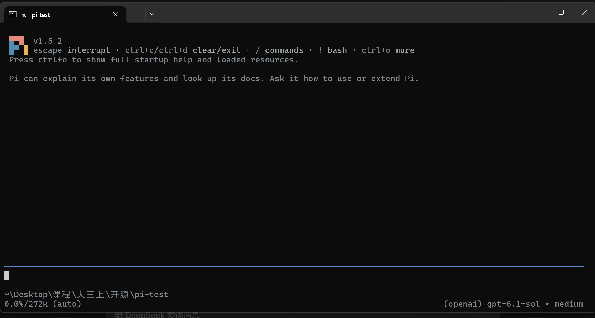
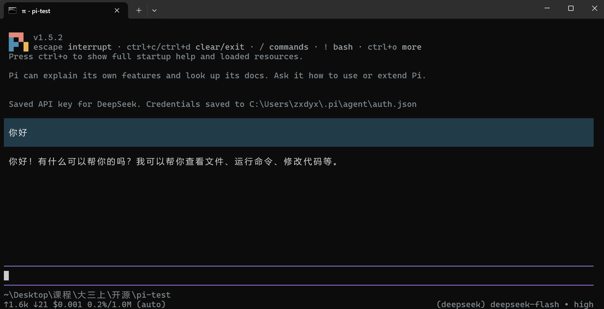
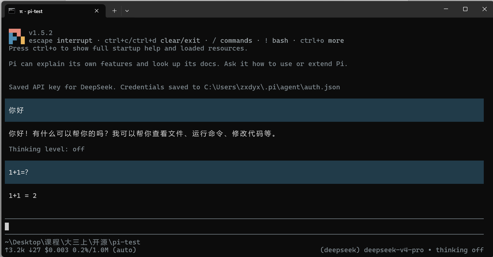
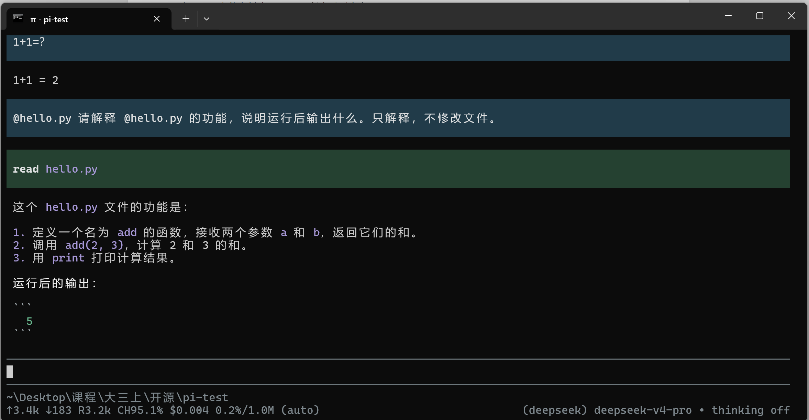
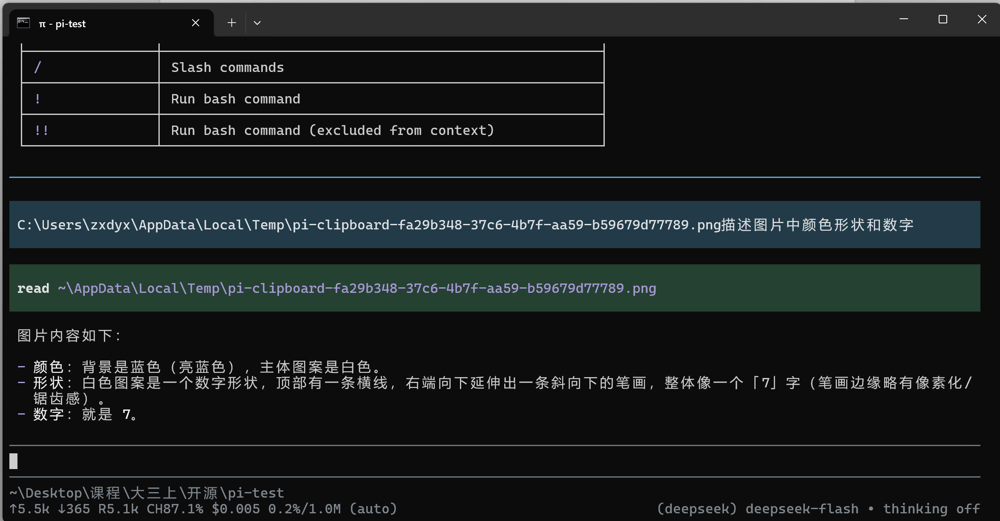
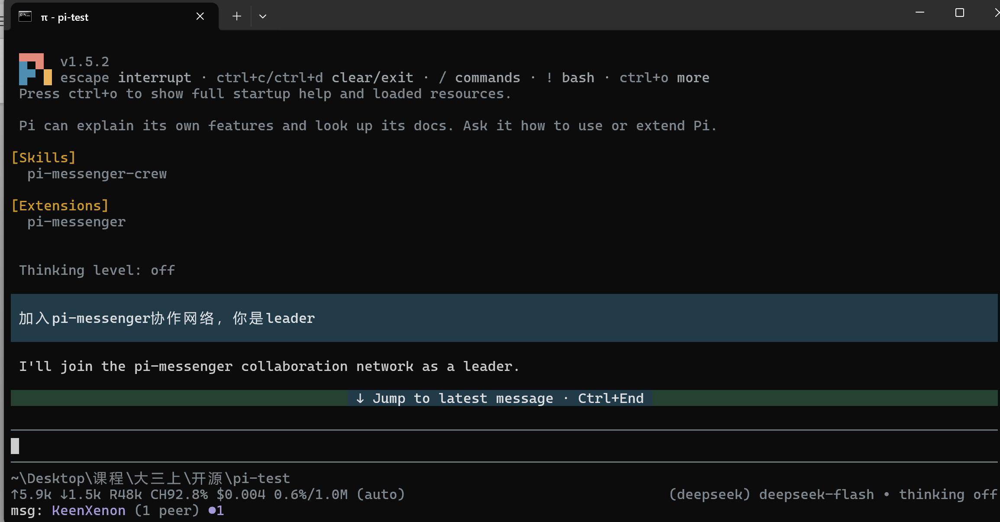
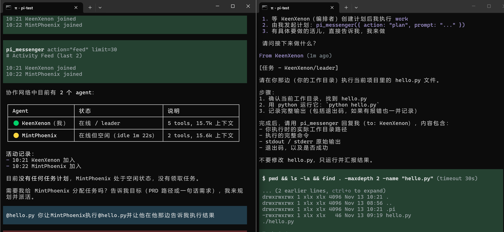
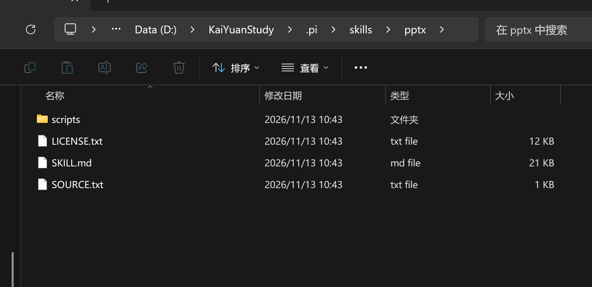
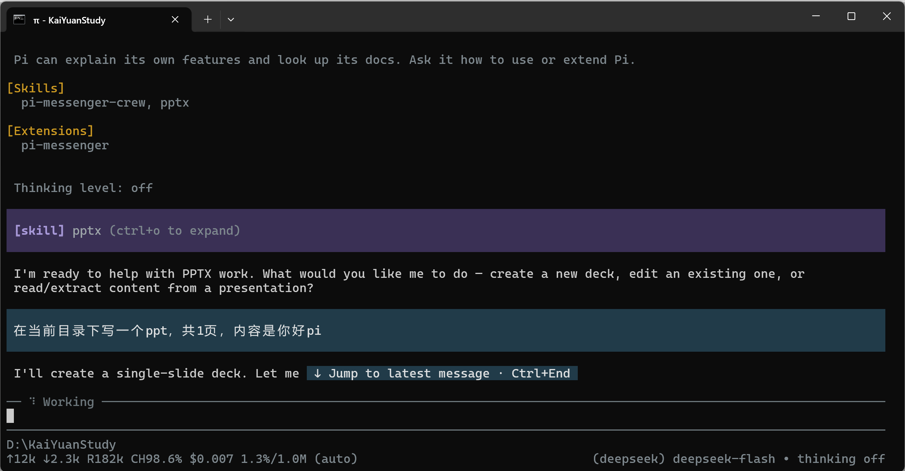
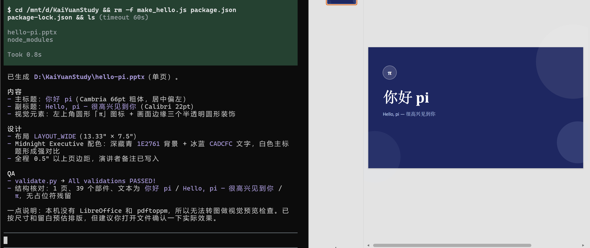

# 第一次实践课 Pi Agent 安装与基础使用

Pi 版本 v1.5.2, 工作目录为 `~\Desktop\课程\大三上\开源\pi-test`, 全部截图来自本机操作。

## 一 安装与启动 S1

启动后界面显示版本 v1.5.2 与当前工作目录, 状态栏显示模型为 openai 的 gpt-6.1-sol, 思考级别为 medium。

## 二 第一次对话 S2

配置 DeepSeek 密钥后输入 `你好`, 模型正常回复。状态栏显示模型为 deepseek-flash, 思考级别为 high。

## 三 切换模型与思考级别 S3

把模型切换为 deepseek-v4-pro, 思考级别切到 off, 同一会话里继续提问 `1+1=?`, 得到 `1+1 = 2`。切换前后的状态见第一张与第三张截图的状态栏。

## 四 文件引用 S4

用 `@hello.py` 引用文件, 要求只解释不修改。模型调用 read 读取 hello.py, 说明它定义 add 函数并打印 2 与 3 的和, 运行输出为 5。

## 五 粘贴图片并要求解释 S5

粘贴一张 196x200 的小图并提问颜色形状和数字。模型读取剪贴板生成的图片文件后回答: 背景蓝色, 主体白色, 数字是 7。原始小图与对话见下。

## 六 扩展 Pi-messenger S6

安装 Pi-messenger 插件后重新启动 Pi, 两个 agent 组成协作网络。leader 把运行 hello.py 的任务派给另一个 agent, 对方执行后回传工作目录、命令输出与退出码。

## 七 pptx 技能安装与发现 S7

技能安装在 `D:\KaiYuanStudy\.pi\skills\pptx`, 目录含 SKILL.md 与 scripts 与 LICENSE。从 KaiYuanStudy 启动 Pi 后, 启动信息里的 [Skills] 列出 pptx, 并可通过 `/skill:pptx` 调用。

## 八 生成的 ppt S8

用 pptx 技能生成单页 `hello-pi.pptx`, 主标题为 你好 pi, 副标题为 Hello, pi - 很高兴见到你。

## 附 文件说明

1. 本报告为 `报告.md`。
2. 全部截图位于同目录 `截图` 下, 共 11 张。
3. 仓库地址为 https://github.com/zx-123470/---
