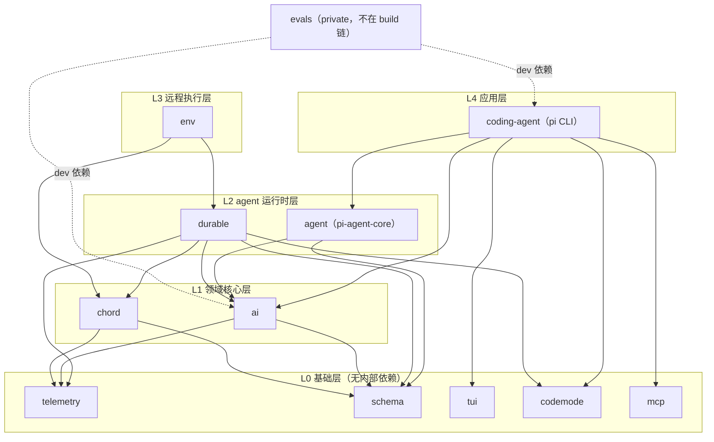

# 任务三：分析子模块功能与依赖关系

仓库：pi（earendil-works/pi monorepo，本地检出 `pi-hunnu-2026`，main 分支，各包版本 1.5.2）。
分析方法：逐包阅读 `package.json`（scripts / dependencies / peerDependencies / devDependencies）、`README.md`、构建脚本与关键源码，并用 grep 核对源码中真实的 `@earendil-works/*` import，排除注释里的假引用。
本人重点分析的模块：**ai、coding-agent**（构建链最复杂的两个），其余模块同样逐一核实。

## 一、与作业表格的版本差异

作业表格列了 11 个子文件夹，本仓库中全部存在，无缺失；但实际代码比表格多出以下内容：

1. `packages/evals`（npm 名 `@earendil-works/pi-evals`，`private: true`）：评测 harness，没有 build 脚本，**不在根 build 链中**。它以 devDependencies 依赖 `pi-ai` 和 `pi-coding-agent`（packages/evals/package.json）。图中用虚线单独标出。
2. `apps/p2`、`apps/p2-mac`、`apps/p3`：应用层，不在根 build 与根 check 范围内。p2 依赖 chord、durable、env、ai、codemode、mcp、schema、telemetry、tui；p3 依赖 chord、schema、telemetry（apps/*/package.json）。它们属于"使用方"，不影响 11 个包之间的层级。
3. 目录名与 npm 名不完全一致：`packages/agent` 的 npm 名是 `@earendil-works/pi-agent-core`，`packages/chord` 的 npm 名是 `@earendil-works/chord`（无 pi- 前缀）。
4. 11 个模块之间的内部依赖**全部是运行时依赖**（dependencies），相互之间没有内部 dev 依赖；唯一的内部 dev 依赖来自表格外的 evals。chord 的 `esbuild`、`react`、`ws` 是**可选外部 peer 依赖**（peerDependenciesMeta 标 optional，只被 `/plugins`、`/react`、`/http` 等子入口使用），不是内部模块，图中不画。
5. 根 `tsconfig.json` 的 paths 里还留着 `@earendil-works/pi-agent-old` 别名，但 `packages/agent-old` 目录已不存在，属于过期别名，不构成依赖。

## 二、模块功能、build 与直接内部依赖

"直接内部依赖"只统计 monorepo 内 `@earendil-works/*` 包的 dependencies；外部 npm 依赖另注。所有包的默认 build 都是 `tsc -p tsconfig.build.json`：该配置继承根 `tsconfig.base.json`（ES2024、declaration + declarationMap、sourceMap、erasableSyntaxOnly），把 `src/` 编译为 `dist/` 下的 ESM `.js` + `.d.ts`。下表只列出与默认不同的部分。

| 子文件夹 | 代码主要实现什么功能 | 本模块 build 执行什么、生成什么 | 直接依赖哪些内部模块 | 依据文件或代码位置 |
|---|---|---|---|---|
| telemetry | 厂商中立的遥测契约：回调式 `TelemetryContext`/`TelemetrySpan`、跨进程传播与 span link、counter/histogram 等指标与类型化指标 schema、NOOP 与内存参考实现；不含 exporter、不绑后端 | `tsc -p tsconfig.build.json` → `dist/`（js + d.ts + map） | 无 | packages/telemetry/package.json:31（build）、无 dependencies 字段；README.md:3-15 |
| schema | 不用 eval 的 JSON Schema（draft 2020-12 与 7）builder + 校验器：schema 一次编译成普通闭包，严格 CSP 下可用、零运行时依赖；错误带 JSON Pointer 路径；`Static<typeof S>` 推导类型 | `tsc` → `dist/`。devDeps 里的 ajv/zod/typebox 等只用于测试与 bench 对比，不进入产物 | 无 | packages/schema/package.json:29、50-59；README.md:3-12 |
| chord | 跨进程对象运行时：对象类型=契约（用 pi-schema 的 builder 描述）、引用而非对象本体、文档/事务/derive/job、principal 隔离、插件热重载、SQLite store 与迁移、HTTP/workers/web/tui 客户端面、telemetry-sqlite 存储 | `tsc` → `dist/`（26 个子入口各自编译） | pi-schema、pi-telemetry；可选外部 peer：esbuild、react、ws | packages/chord/package.json:151、172-190；README.md:3-42 |
| tui | 终端 UI 框架：差分渲染（只重画变化行）、CSI 2026 同步输出防闪烁、组件体系（Editor、Markdown、SelectList、Image 等）、Kitty/iTerm2 内联图片、自动补全；另带各平台 native 剪贴板等加速模块 | `tsc` → `dist/`；`build:native:{darwin,linux,win32}` 另行编译 native prebuilds（win32 走 `node native/win32/build.mjs` 产 `.node`），不在默认 build 内 | 无（外部：get-east-asian-width、marked、marked-cjk-friendly） | packages/tui/package.json:9-12、54-58；README.md:3-16 |
| codemode | 在 QuickJS（WASM）沙箱里跑模型写的 JavaScript，唯一能力是调用注入的 tools；嵌套工具调用不进 LLM 上下文。三种沙箱：Node/Bun worker 线程、Cloudflare Durable Object、调用线程内联 | `tsc` → `dist/` | 无（外部：quickjs-wasi） | packages/codemode/package.json:46、69-71；README.md:3-14 |
| mcp | 独立 MCP 客户端：传输中立的核心（请求关联、初始化、超时、取消）+ stdio / Streamable HTTP / Pipe / 内存测试四种传输，OAuth 子入口；不依赖官方 MCP SDK | `tsc` → `dist/` | 无（外部：cross-spawn）。源码里出现的 pi-ai、pi-env 字样只是注释（src/protocol/content.ts:75、src/transports/pipe.ts:7） | packages/mcp/package.json:34、53-55；README.md:3-5 |
| ai | 统一 LLM API：多 provider（Anthropic/OpenAI/Google/Bedrock 等）流式调用与工具调用、模型目录自动生成、auth 自动解析与 OAuth、token/成本统计、跨 provider 会话交接、图像与分类 | 两步：`generate-models`（`node catalog/generate.ts --strict`，从 catalog/ 定义再生 `src/models.generated.ts` 与 provider 数据）→ `build:offline`（`check:model-data` + `tsc` + 把 `src/providers/data` 拷进 `dist/providers/data`）。另产 CLI `bin pi-ai` | pi-schema、pi-telemetry | packages/ai/package.json:76-77、84-85；catalog/generate.ts；README.md:3 |
| durable | 持久化 agent harness（实验性）：对话、模型 turn、工具调用与自定义状态先落存储再展示；进程中途死掉后重开存储可续跑，死掉的模型请求算失败尝试并重试。存储适配器 memory/indexeddb/jsonl/sqlite，扩展、codemode、图像、tool-search | `tsc` → `dist/` | chord、pi-ai、pi-codemode、pi-schema、pi-telemetry | packages/durable/package.json:133、166-174；README.md:5-7 |
| env | Durable 的远程执行环境：Rust 写的 `pi-env` daemon 在远端跑（stdin/stdout 帧协议），`RemoteExecutionEnv` 实现 Durable 的 `ExecutionEnv`，经 SSH 部署并按 SHA-256 校验 daemon；`LocalExecutionEnv` 提供 listFiles | `tsc` → `dist/`（TS 客户端）；`build:daemon` 另行 `cargo build --manifest-path daemon/Cargo.toml --locked`，各平台预编译 daemon 随包放在 `bin/`，不在默认 build 内 | chord、pi-durable | packages/env/package.json:26-27、47-50；README.md:3-10 |
| agent | 通用有状态 agent 循环（npm 名 pi-agent-core）：prompt → 流式模型响应 → 工具执行 → 事件流；状态管理、附件、`AgentMessage` 与 `convertToLlm` 桥接自定义消息 | `tsc` → `dist/` | pi-ai、pi-schema | packages/agent/package.json:21、25-28；README.md:3、43-49；src/agent-loop.ts:736 |
| coding-agent | `pi` CLI 本体：交互 TUI / print / JSON / RPC 四种模式，read、bash、edit、write 等工具，会话管理与导出，extensions/skills/themes/pi packages 扩展体系 | 两步：`build:unbundled`（`tsc` + 给 cli/rpc-entry 加可执行位 + copy-assets 主题/图片/HTML 模板）→ `node ../../scripts/build-coding-agent-bundle.mjs`：esbuild 把自身 dist 与 ai/dist 的 cli、index、rpc-entry 及懒加载入口（各 OAuth flow、bedrock、codemode worker、image-resize worker）打成自包含 `dist/bundle/`，`bin pi` 指向 `dist/bundle/cli.js`；另有可选 `build:binary` 用 bun 编译单文件 | pi-agent-core、pi-ai、pi-codemode、pi-mcp、pi-tui | packages/coding-agent/package.json:9-11、33-37、43-48；scripts/build-coding-agent-bundle.mjs:140-259 |

核对说明：chord 源码中 `@earendil-works/pi-durable/env` 只出现在注释（src/sync/files.ts:3），不是依赖，否则会与 durable 形成环；grep 全量 import 后确认上表与 package.json 完全一致。

## 三、模块层级与依赖关系图

箭头方向统一为"使用方 → 被依赖方"。实线为运行时直接依赖（各包 dependencies），虚线为开发依赖（evals 的 devDependencies）。可选依赖均为外部 npm 包（chord 的 esbuild/react/ws），不属于内部模块，故不入图，见上表。

图源文件：`模块依赖图.mmd`（Mermaid 源，可编辑）；`模块依赖图.html`（浏览器打开即渲染）；`模块依赖图.png`（渲染结果）；`模块依赖图.svg`（矢量版，可无限放大）。

层级划分依据：按"直接内部依赖所落在的层"自底向上归纳，且每层只依赖更低的层（DAG，无环）。

- L0 基础层：telemetry、schema、tui、codemode、mcp，dependencies 中没有任何内部包，可独立发布、独立构建。
- L1 领域核心层：chord（对象/文档/插件运行时）与 ai（模型访问），都只依赖 L0 的 schema + telemetry。
- L2 agent 运行时层：durable（持久化 harness，组合 chord 的状态 + ai 的模型 + codemode 的沙箱）与 agent（内存态 agent 循环，组合 ai + schema）。
- L3 远程执行层：env，把 durable 的工具执行搬到远端，依赖 durable 与 chord。
- L4 应用层：coding-agent，把 agent 循环、ai、codemode、mcp、tui 组装成面向用户的 CLI。
- evals 不参与运行链路，是开发期评测工具，单独画在层外。

注意 coding-agent 并不依赖 durable/chord/env：CLI 走的是 agent 的内存态循环；durable 一线服务于 apps/p2 这类应用。两条 agent 路线并存是本仓库的一个实际结构特点。

## 四、结合分析回答

### 1. 根目录与子模块中的 npm run build 分别读取什么配置、执行什么工作？

根目录：读根 `package.json` 的 `scripts.build`（package.json:15）。它**不读 workspace 依赖拓扑**，而是一条写死的命令链：依次 `cd` 进 telemetry、schema、chord、tui、codemode、mcp、ai、durable、env、agent、coding-agent 并执行各自的 `npm run build`。另有 `build:offline` 变体，唯一区别是 ai 改用 `build:offline`（跳过模型目录再生，只做校验与编译）。

子模块：每个包读自己的 `tsconfig.build.json`（`outDir: ./dist`、`rootDir: ./src`、NodeNext），继承根 `tsconfig.base.json` 的编译选项，用 `tsc` 把 TS 编译成 ESM js + d.ts + sourcemap。三个例外：

- ai：先跑 `catalog/generate.ts --strict` 再生模型目录代码与数据，再编译并拷贝 provider 数据进 dist；
- coding-agent：编译后再跑 `scripts/build-coding-agent-bundle.mjs`，用 esbuild 以**已编译的 dist** 为输入做自包含 bundle（脚本会检查 `packages/ai/dist` 等入口存在，否则报"Build the workspace packages first"，见该脚本 140-152 行），并拷贝主题/模板资产；
- tui 与 env：默认 build 只编译 TS；native `.node` 模块（tui）和 Rust daemon（env，cargo）由独立脚本构建，产物以 prebuild 形式随包发布。

与之对照，`npm run check` 走根 `tsconfig.json`：`noEmit`，且 paths 把全部 `@earendil-works/*` 别名指向各包 **src**，所以类型检查不需要先 build；需要 dist 的是 bundle、起子进程或 esbuild 打包的测试这类消费构建产物的场景。

### 2. 构建顺序和模块依赖有什么关系？相邻构建的模块是否一定互相依赖？

关系：根 build 的固定顺序是依赖 DAG 的**一个拓扑序**——每个包的内部依赖都排在它前面（如 chord 在 schema、telemetry 之后；durable 在 chord、ai、codemode 之后；coding-agent 最后）。这是硬要求，因为 coding-agent 的 bundle 直接读别包的 dist，被依赖方必须先产出构建产物。

相邻不一定依赖。10 个相邻对中只有 4 对存在直接依赖：schema→chord、ai→durable、durable→env、agent→coding-agent。其余 6 对（telemetry→schema、chord→tui、tui→codemode、codemode→mcp、mcp→ai、env→agent）彼此无依赖，只是被串行排在一起：它们交换顺序甚至并行构建都不影响正确性。例如 mcp 没有任何内部依赖，却被排在 ai 前面，仅仅因为链是写死的串行命令。所以"构建顺序"是拓扑序的一种串行实现，蕴含依赖约束，但相邻位置本身不携带依赖信息。

### 3. 一条涉及至少三个模块的依赖路径及分工

选 **coding-agent → agent → ai → schema**（4 个模块）。具体 trace：用户在 pi 交互模式输入"读 package.json 并总结"。

1. coding-agent（L4）：pi-tui 渲染输入框与会话界面；`AgentSession`（src/core/agent-session.ts:34 起从 pi-agent-core 导入）组装 system prompt、read/bash/edit/write 工具集与会话状态，调用 `Agent.prompt`。它负责"产品形态"：界面、工具实现、会话持久化、扩展体系。
2. agent（L2）：`agent-loop` 跑循环——把 messages + tools 交给 `streamFn`，消费模型流事件；遇到工具调用先做参数校验（src/agent-loop.ts:736 `validateToolArguments`），再执行工具、把 toolResult 写回 messages 继续下一轮，同时向上订阅者发事件。它负责"循环与状态"，不关心界面也不关心具体 provider。
3. ai（L1）：提供 `streamFn`（`models.streamSimple`）：选 provider 与 API 实现（如 anthropic-messages）、解析 auth/OAuth、流式返回 delta、统计 token 与成本。工具参数的校验函数也在这一层：`src/utils/validation.ts:15` 用 pi-schema 的 `compile(schema, { formats, coerce: true, ... })` 编译工具参数 schema。它负责"模型访问"，把各家 API 差异抹平。
4. schema（L0）：`compile()` 把 JSON Schema 编译成闭包，对模型产出的工具 arguments 做校验与 coerce，错误以 JSON Pointer 定位字段。它负责"数据形状"，零依赖、可在严格 CSP 下运行。

分工总结：界面与工具在顶层，循环在中层，模型访问在下层，形状校验在底层；每层只调用下一层的导出，替换某一层（如换 provider、换 UI）不需要改其他层。另一条同构路径是 env → durable → chord → schema：远程工具执行（env）建立在持久化 harness（durable）之上，harness 的文档状态交给对象运行时（chord），契约与参数形状仍由 schema 描述。

## 五、附：文件清单

- 本报告：`任务三-模块功能与依赖分析.md`
- 可编辑图源：`模块依赖图.mmd`（Mermaid）、`模块依赖图.html`（内嵌同一份源，浏览器打开即渲染，可直接改）
- 可阅读图：`模块依赖图.png`、`模块依赖图.svg`（矢量）