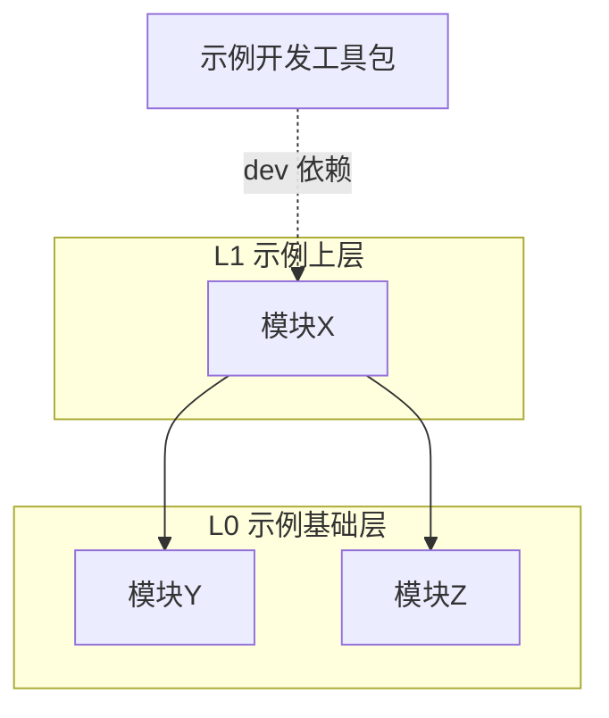

# 任务三实施工作说明

依据本目录 02-Pi-Agent-fork.md 的任务三一节。本文只说明怎么做, 给出步骤, 每步读什么文件, 跑什么命令, 如何核实, 如何产出交付物。不包含现成分析结论, 所有结论须按本文步骤在自己的检出上重新得出。提交由本人自行完成, 本文不包含提交步骤。

## 0. 交付物与验收标准

1. 模块分析表, 11 行乘 4 列。11 行为 telemetry, schema, chord, tui, codemode, mcp, ai, durable, env, agent, coding-agent。4 列为功能, build 执行什么生成什么, 直接依赖哪些内部模块, 依据文件或代码位置。
2. 模块层级图与依赖关系图, 含可阅读图与可编辑图源。箭头统一使用方指向被依赖方。写明层级划分依据。只画有依据的直接依赖。开发依赖与可选依赖若入图必须明确区分。
3. 三个问题的回答。根与子模块 npm run build 读什么配置做什么工作。构建顺序与依赖的关系, 相邻构建是否一定互相依赖。一条不少于 3 个模块的依赖路径及分工。
4. 版本差异说明, 本人检出与表格相比的增减, 以实际代码为准。
5. 重点分析模块明确为 ai 和 coding-agent, 即构建链最复杂的两个包。ai 的 build 含模型目录生成, 编译, 数据拷贝三段。coding-agent 的 build 含编译, esbuild 打包, 资产拷贝三段。这两个包的构建脚本须完整读一遍。报告语言风格为用 1. 2. 3. 列点说明, 语言简洁, 只回答问题, 不写心得与感想。标点只用逗号, 句号, 冒号三种, 不用顿号, 分号, 括号, 引号, 感叹号等其它标点。
6. 产出位置为 C:\Users\zxdyx\Desktop\课程\大三上\开源\pi作业2 目录。在该目录生成 报告.md, 收录模块分析表, 三个问题的回答, 版本差异说明, 层级划分依据等全部报告内容。模块层级图与依赖关系图的可阅读图和可编辑图源也生成在同一目录。报告.md 用相对路径引用图。
7. 阅读方式为每位成员全量阅读全部 11 个模块, 不做分工阅读。小组讨论只作交叉核对, 不替代本人阅读。

## 1. 前置条件

1. 任务二已完成, clone 地址, 分支, 提交编号已记录, S1 截图已留。
2. 本文命令默认在仓库根目录执行, 路径写法按自己的 shell 调整。
3. 阅读步骤不需要安装依赖。第 3.4 节的实跑验证才需要 npm install --ignore-scripts。

## 2. 第一步，定范围核差异

1. 列目录 ls packages 与 ls apps, 把实际包目录与表格 11 行逐一对照。记录多出的包, 缺少的目录, 目录名与 npm 包名不一致的情况, 后者看各包 package.json 的 name 字段。
2. 读根 package.json 的 scripts.build, 把它 cd 进的包按顺序抄下得到根构建链。核对链上包与表格是否一致, 链外的包单独说明用途与是否参与构建。
3. 记录根 scripts 里构建相关变体与 check 脚本, 第 5 节 Q1 会用到。
4. 差异写进 报告.md 的独立小节, 多了什么, 少了什么, 各自依据哪个文件。

## 3. 第二步，逐模块收集四类证据

每人对 11 个包各做一遍以下四件事, 边读边填表。每格结论都要落到文件加行号, 行号以本人检出为准。

### 3.1 功能

1. 读 packages 下该包 README.md 开头与 src 目录结构, 有 docs 的扫一眼设计文档标题。
2. 用自己的话写它解决什么问题, 对外提供什么能力, 一两句话加关键机制。不照抄 package.json 的 description 或 README 原句。
3. 看 exports 子入口列表判断能力面, 以及哪些入口跑在 Node, 哪些跑在浏览器。

### 3.2 build 执行什么生成什么

1. 读该包 package.json 的 scripts.build, 把命令链拆成步骤逐步追。
2. tsc -p tsconfig.build.json 步骤读该文件与它 extends 的根 tsconfig.base.json, 确认 rootDir, outDir, declaration, sourceMap 等, 结论即 src 编译为 dist 下的 js 加 d.ts 加 map。
3. 非 tsc 步骤打开被调用的脚本读输入与输出, 写清读什么, 产什么, 产物落在哪。bundle 脚本尤其注意是否以别包已编译的 dist 为输入。
4. 区分默认 build 包含的步骤与独立脚本才跑的步骤, 如 native prebuild 与 Rust daemon。后者注明不在默认 build 内, 看 files 字段说明产物以何种形式随包发布。
5. 看 bin 字段, 有 bin 的包说明 build 产出的可执行入口指向哪个文件。

### 3.3 直接内部依赖

1. 只统计 monorepo 内部包, 即 @earendil-works 前缀的包, 分三类记录。
2. dependencies 中的内部包为运行时直接依赖, 是表格与图实线的唯一来源。
3. peerDependencies 加 peerDependenciesMeta 标 optional 的为可选依赖, 注明是内部还是外部 npm 包, 被哪些子入口使用。
4. devDependencies 中的内部包为开发依赖, 对应图虚线。
5. 外部 npm 依赖不属于内部模块, 可在表格中另作说明但不进依赖图。
6. 核实必做, 用源码真实 import 暴露声明未用与注释假引用两类错误:

```bash
grep -rhoE "@earendil-works/[a-z-]+(/[a-z/-]+)?" packages/包名/src --include="*.ts" | sort -u
```

7. grep 结果比 dependencies 多时逐条 grep -rn 看上下文, 区分真实 import 与注释或文档字符串, 注释不算依赖。grep 结果比 dependencies 少时正常, 以 dependencies 为准记录直接依赖。
8. 发现疑似环时回源码确认其中一条是否为注释, 正常构建不可能有环。

### 3.4 可选实跑验证

1. 时间允许时 npm install --ignore-scripts 后跑根 npm run build, 观察各包 dist 产物与 bundle 输出日志, 对照 3.2 的书面结论。
2. 再跑 npm run check, 观察它是否不需要 dist, 看根 tsconfig 的 noEmit 与 paths。
3. 实跑不是作业硬性要求, 但能把 build 生成什么从推断变成观察。遵守仓库 AGENTS.md 约束, 不跑生命周期脚本, 不擅自跑全量测试。

## 4. 第三步，画层级与依赖图

1. 节点为表格 11 个模块。第 2 步发现的额外包若入图, 单独标注身份, 如 private 与不在构建链。
2. 边仅为 3.3 核实过的运行时直接依赖, 方向使用方指向被依赖方。开发依赖用虚线加文字标签。可选依赖入图同样虚线或点线加标签。外部可选 peer 在图例文字中说明而不画节点。
3. 分层自底向上归纳。内部依赖为空的包归 L0。其余包的层等于其直接依赖所在最高层加 1。同层包互不依赖。检查全图无环。每层写一句划分依据, 说明该层承担什么角色, 只依赖哪些更低层。
4. Mermaid 写法为 flowchart TD 加 subgraph 分层, 实线边 A --> B, 虚线边 A -. 标签 .-> B, 配色用 classDef 与 class。骨架如下, 示例节点非结论:



5. 产出两种形态, 全部放在 pi作业2 目录。可编辑图源为 .mmd 文本, 或 draw.io 的 .drawio, 或 PPT 的 .pptx。可阅读图用 mermaid-cli 渲染, 或内嵌 mermaid CDN 的 HTML 在浏览器渲染后导出截图, 或 draw.io 导出 PNG 或 SVG, 任选其一, 保证中文标签正常显示。
6. 读图自检。打开产出的图逐边对照依赖表, 边数, 方向, 虚实与表一致, 节点无遗漏, 层级标签与依据文字一致。图与表不一致时以核实过的 package.json 为准改图。

## 5. 第四步，三个问题的作答方法

### Q1 根与子模块的 npm run build

1. 证据链为根 package.json 的 scripts.build 原文, 各包 scripts.build, tsconfig.build.json, 根 tsconfig.base.json。
2. 判断根读的是写死的命令链还是 workspace 拓扑, 把根读什么, 子读什么, 各产什么分层写清, 单列有代码生成, bundle, 资产拷贝, native 或 cargo 步骤的特殊包。
3. 对照根 check 脚本与根 tsconfig.json 的 noEmit 与 paths 指向 src 还是 dist, 说明哪些场景必须先 build, 哪些不需要。

### Q2 构建顺序与依赖的关系

1. 把第 2 步抄下的构建链与第 3 步依赖表对照, 验证链是依赖图的一个拓扑序, 即每个包的内部依赖都排在它前面, 举一两个正例。
2. 把链上所有相邻对列成小表, 逐对标注有或无直接依赖, 据此回答相邻是否一定互相依赖, 并指出无依赖的相邻对可以换序或并行。
3. 解释为什么仍要保证被依赖方先构建, 找出消费别包 dist 的证据, 如 bundle 脚本的输入检查, 起子进程或打包的测试。结论区分顺序蕴含的约束与相邻位置本身不携带的信息。

### Q3 一条不少于 3 模块的依赖路径与分工

1. 选一条自己读得最透的链, 建议包含一个应用层包和一个基础层包。
2. 先给路径, 再给一条具体 trace, 即一个用户操作或一次调用依次经过各模块时每个模块做什么, 不做什么, 引用文件加行号证明衔接点, 例如上层在哪里调用下层的哪个导出。
3. 分工描述落到每层对外提供什么, 屏蔽什么, 避免复述功能简介。

## 6. 第五步，成文与自查

1. 全量阅读。每位成员独立读完全部 11 个模块的 README, package.json, 构建配置与关键源码, 不做分工阅读。小组讨论仅作交叉核对, 讨论得到的结论也要回到自己检出上核实行号。
2. 报告写入 pi作业2 目录的 报告.md。重点分析模块为 ai 和 coding-agent, 证据为这两个包完整读过的构建脚本。
3. 语言风格用 1. 2. 3. 列点说明, 语言简洁, 只回答问题, 不写心得。标点只用逗号, 句号, 冒号。
4. 自查清单:
   1. 表格 44 格无待分析, 每格有依据文件加行号。
   2. 每条图边能在某包 dependencies 中找到原文, 方向正确。
   3. 开发依赖与可选依赖已区分, 或说明不入图理由。
   4. 层级依据, 版本差异, 重点模块声明齐全。
   5. 三问均有证据, Q2 的相邻对逐对核过。
   6. 图源与可阅读图都在 pi作业2 目录, 能正常打开, 中文不乱码。
   7. 报告.md 用相对路径引图, 图文件与报告同目录。
   8. 全文标点只有逗号, 句号, 冒号, 无心得段落。
5. 常见坑: 把 npm description 当功能, 把 devDependencies 当运行时依赖, 把注释里的包名当依赖, 默认相邻构建即依赖, 箭头画反, 只交图不交图源。