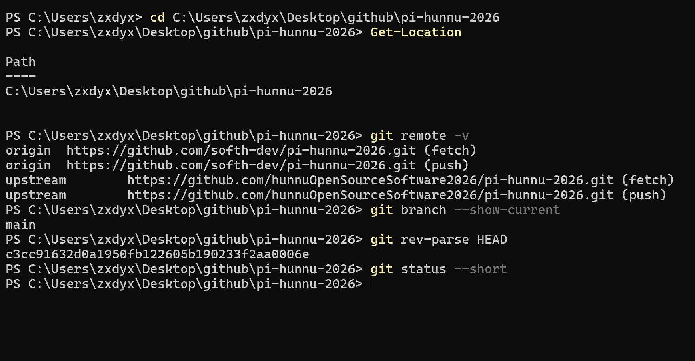
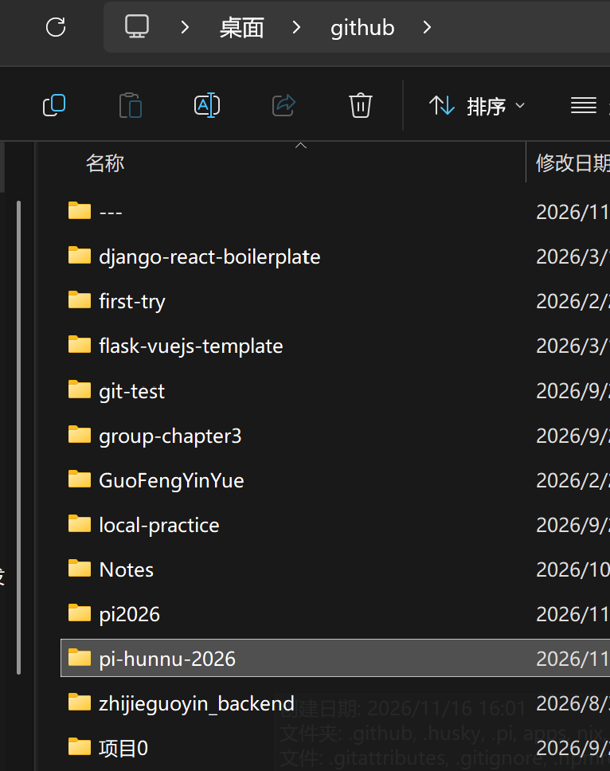
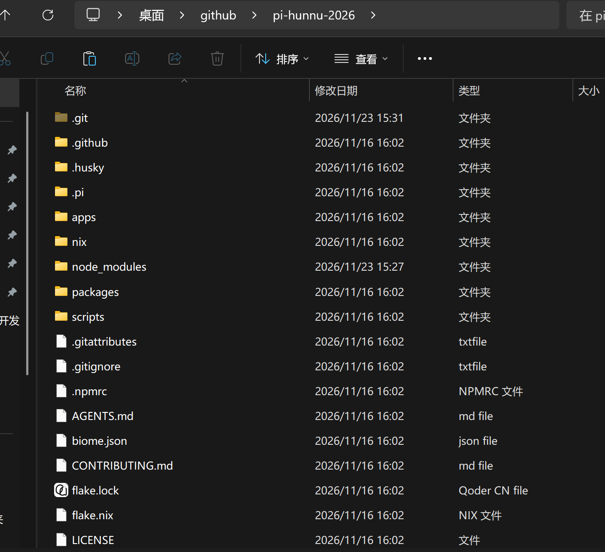
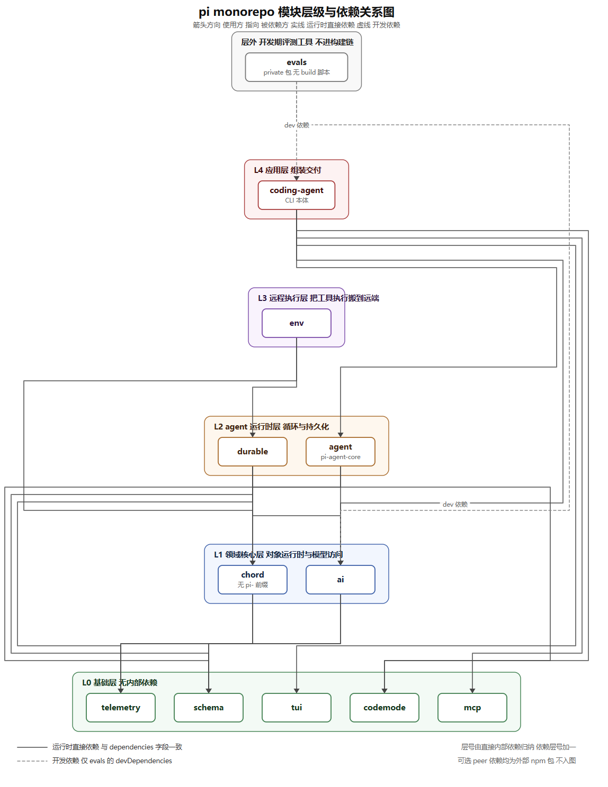

**实际 Clone 地址：** https://github.com/softh-dev/pi-hunnu-2026

**Git 命令执行结果（对应 S1 截图）：**

**本地 Clone 仓库信息：**

**源码目录结构：**

# 任务三 模块功能与依赖分析

本人重点分析的模块为 ai 与 coding-agent。

## 一 构建顺序

1. 根 scripts.build 是一条写死的 cd 链, 依次进入 11 个包目录执行 npm run build, 依据 package.json:15。下表就是这条链的顺序, 它同时是依赖图的一个拓扑序, 每一步只做本包的事。
2. 每步执行的步骤与产物如下。

| 序 | 包 | 本步执行的步骤 | 产物 |
|---|---|---|---|
| 1 | telemetry | `tsc -p tsconfig.build.json` | dist 下的 ESM js 与 d.ts 与两份 map |
| 2 | schema | `tsc`, 一并编译 formats 子入口 | dist/index.js 与 dist/formats |
| 3 | chord | `tsc`, 26 个子入口 | dist 下对应各子入口的 js 与 d.ts |
| 4 | tui | `tsc` | dist |
| 5 | codemode | `tsc` | dist 六个子入口 |
| 6 | mcp | `tsc` | dist 与 dist/oauth 与 dist/testing |
| 7 | ai | 生成模型目录, 校验生成数据, `tsc`, 拷贝 provider 数据 | dist 与 dist/cli.js 与 dist/providers/data |
| 8 | durable | `tsc`, paths 指向 chord 与 ai 的 dist | dist 与 19 个子入口 |
| 9 | env | `tsc`, paths 指向 chord 与 durable 的 dist | dist |
| 10 | agent | `tsc`, paths 指向 ai 的 dist | dist |
| 11 | coding-agent | `tsc` 与加可执行位与拷贝资产, 再用 esbuild 打包 | dist/bundle/cli.js 与 chunks 与主题与模板资产 |

3. 三处需要单独说明的步骤。
   1. ai 的第一段是代码生成, 从上游目录再生 src/models.generated.ts 与 src/providers 下的分片与数据, 所以要联网, 之后才编译并拷贝数据。
   2. coding-agent 的打包以自身 dist 与 ai 的 dist 与 ai 的 src 为输入, 缺入口时报 Build the workspace packages first, 这也是它排在最后的原因。
   3. durable 与 env 与 agent 与 coding-agent 的编译要读兄弟包 dist 里的 d.ts, 所以不能插队。
4. 不在默认 build 内的步骤有三处, 都靠独立脚本跑, 产物以 prebuilds 与 bin 与单文件形式随包发布。tui 的 native 编译, env 的 cargo daemon, coding-agent 的 bun 单文件。
5. 根构建链的变体只有一个, build:offline 把 ai 换成离线校验, 其余十步相同, 依据 package.json:16。

## 二 模块分析表

表中的直接内部依赖只统计 packages 下的包, 依据是包目录是否存在, 不是 npm scope 前缀。默认 build 指各包 scripts.build, 默认 build 之外的步骤单独注明。

| 子文件夹 | 代码主要实现什么功能 | 本模块 build 执行什么生成什么 | 直接依赖哪些内部模块 | 依据文件或代码位置 |
|---|---|---|---|---|
| telemetry | 厂商中立的遥测契约。提供回调式 TelemetryContext 与 TelemetrySpan, 跨进程传播与 span link, counter 与 histogram 与类型化指标 schema, NOOP 实现与内存参考实现。不含 exporter, 不绑任何后端。 | `tsc -p tsconfig.build.json` 把 src 编译为 dist 下的 ESM js 与 d.ts 与 js.map 与 d.ts.map。tsconfig.build.json 只补 outDir 为 ./dist 与 rootDir 为 ./src, 编译选项全部继承根 tsconfig.base.json。 | 无 | packages/telemetry/package.json:31 与 :8-24, packages/telemetry/tsconfig.build.json:2-5, README.md:3-15 |
| schema | 不用 eval 的 JSON Schema builder 与校验器。支持 draft 2020-12 与 draft 7, schema 一次编译成普通闭包, 严格 CSP 下可用, 错误以 JSON Pointer 定位, Static 推导出校验后的类型。 | `tsc -p tsconfig.build.json`, 一并编译 ./formats 子入口到 dist/formats。devDependencies 里的 ajv 与 zod 与 typebox 与 @cfworker/json-schema 与 ata-validator 只用于测试与 bench 对比, 不进产物。 | 无 | packages/schema/package.json:29 与 :8-19 与 :50-59, README.md:3-12 |
| chord | 跨进程对象运行时。对象类型即契约, 对外只发引用不发对象本体, 文档在事务里写入 store, derive 与 job 由对象拥有, 每次调用带 principal 并按 principal key 隔离实例, 插件可在运行中重载, 另有 SQLite store 与 HTTP 与 workers 与 web 与 tui 客户端面与 telemetry-sqlite 存储。 | `tsc -p tsconfig.build.json`, 26 个模块子入口按 exports 表一一落到 dist 对应路径。默认 build 不含 native 也不含 esbuild 打包。 | pi-schema, pi-telemetry。可选外部 peer 为 esbuild 与 react 与 ws。 | packages/chord/package.json:151 与 :8-140 与 :172-191, README.md:3-30, 源码 grep 仅得 pi-schema 与 pi-telemetry 两个内部包 |
| tui | 终端 UI 框架。差分渲染只重画变化行, CSI 2026 同步输出防闪烁, 组件体系含 Editor 与 Markdown 与 SelectList 与 Image, Kitty 与 iTerm2 内联图片, 文件路径与斜杠命令补全, 另有剪贴板等 native 加速模块。 | 默认只跑 `tsc -p tsconfig.build.json` 产 dist。`build:native:darwin` 与 `build:native:linux` 走 native 下的 shell 脚本, `build:native:win32` 走 native/win32/build.mjs 产 .node, 三者都不在默认 build 内, 产物以 prebuilds 形式随包发布, 见 files 字段。 | 无。外部依赖为 get-east-asian-width 与 marked 与 marked-cjk-friendly。 | packages/tui/package.json:9-12 与 :16-33 与 :54-58, README.md:3-16 |
| codemode | 在 QuickJS 的 WASM 沙箱里执行模型写的 JavaScript, 脚本唯一能力是调用注入的 tools, 嵌套工具调用不进 LLM 上下文。三种沙箱分别为 Node 与 Bun 的 worker 线程与 Cloudflare Durable Object 与调用线程内联。 | `tsc -p tsconfig.build.json` 产 dist, 覆盖 ., /declarations, /source, /portable, /cloudflare, /worker 六个入口。该配置的 files 字段额外带上 src/cloudflare-modules.d.ts 环境声明。 | 无。外部依赖为 quickjs-wasi。 | packages/codemode/package.json:46 与 :8-39 与 :69-71, packages/codemode/tsconfig.build.json 的 files 字段, README.md:3-14 |
| mcp | 独立 MCP 客户端。传输中立的核心负责请求关联与初始化与超时与取消, 传输有 stdio 与 Streamable HTTP 与 Pipe 与内存测试四种, 另有 OAuth 子入口。不依赖官方 MCP SDK, 也不依赖其他 pi 包。 | `tsc -p tsconfig.build.json` 产 dist 与 dist/oauth 与 dist/testing。无代码生成, 无 bundle, 无资产。 | 无。外部依赖为 cross-spawn。源码里出现的 pi-ai 与 pi-env 字样只在注释或文档字符串里, 不算依赖。 | packages/mcp/package.json:34 与 :8-24 与 :53-55, src/protocol/content.ts:75, src/transports/pipe.ts:7 |
| ai | 统一 LLM 接口。多 provider 的流式调用与工具调用, 模型目录由 catalog 定义自动生成, auth 与 OAuth 自动解析, token 与成本统计, 跨 provider 的会话交接, 图像与分类模型目录。 | 生成段 `generate-models` 抓上游目录并再生 src/models.generated.ts 与 src/providers 下的 *.models.ts 与 src/providers/data, 校验段 `check:model-data` 校验生成数据, 编译与拷贝段 `tsc` 编译后把 src/providers/data 拷进 dist/providers/data。另有 bin pi-ai 指向 dist/cli.js。 | pi-schema, pi-telemetry | packages/ai/package.json:72-79 与 :63-65, catalog/generate.ts:98-303, scripts/check-model-data.ts:9-16, scripts/package-files.mjs:14-24 |
| durable | 持久化 agent harness, 实验性。会话与模型 turn 与工具调用与自定义状态先落存储再展示, 进程中途死掉后重开存储可续跑, 死掉的模型请求按失败尝试重试。存储适配器有 memory 与 indexeddb 与 jsonl 与 sqlite, 另有扩展与 codemode 与图像与 tool-search。 | `tsc -p tsconfig.build.json`, 19 个子入口按 exports 表落地到 dist。该配置在 compilerOptions.paths 里把 chord 与 pi-ai 指向兄弟包 dist 下的 d.ts, 所以构建前这两个包的 dist 必须已经存在。 | chord, pi-ai, pi-codemode, pi-schema, pi-telemetry | packages/durable/package.json:133 与 :166-174, packages/durable/tsconfig.build.json:5-16, README.md:5-7 |
| env | Durable 的远程执行环境。Rust 写的小 daemon 在远端跑, 用 stdin 与 stdout 的帧协议做文件与命令操作, RemoteExecutionEnv 实现 Durable 的 ExecutionEnv, 经 SSH 部署并按 SHA-256 部署与校验 daemon。 | 默认 `tsc -p tsconfig.build.json` 只编译 TS 客户端, 该配置把 chord/context 与 pi-durable/env 指向兄弟包 dist。`build:daemon` 另跑 `cargo build --manifest-path daemon/Cargo.toml --locked`, 不在默认 build 内, 预编译 daemon 放在 bin 下随包发布。 | chord, pi-durable | packages/env/package.json:26-27 与 :17-23 与 :47-50, packages/env/tsconfig.build.json:5-8, README.md:3-10 |
| agent | 通用有状态 agent 循环。prompt 进入流式模型响应, 遇到工具调用就校验参数并执行工具, 再把结果写回消息继续下一轮, 同时向订阅者发事件。带状态管理与附件, AgentMessage 与 convertToLlm 负责把自定义消息桥接成模型消息。 | `tsc -p tsconfig.build.json`, 产物为 dist 与 dist/index.d.ts。该配置把 pi-ai 指向 ../ai/dist 的 d.ts。pi-schema 在源码里只用于 Static 类型推导, 不产生运行时调用。 | pi-ai, pi-schema | packages/agent/package.json:21 与 :25-28, packages/agent/tsconfig.build.json:5-8, src/agent-loop.ts:390-417, src/types.ts:17 |
| coding-agent | pi CLI 本体。交互 TUI 与 print 与 JSON 与 RPC 四种模式, read 与 bash 与 edit 与 write 等工具, 会话管理与导出, extensions 与 skills 与 themes 与 pi packages 扩展体系。 | 编译段 tsc 并给 dist/cli.js 与 dist/rpc-entry.js 加可执行位, 资产段 copy-assets 拷主题 json 与图片 png 与 export-html 的 html 与 css 与 js 与 vendor, 打包段 `build-coding-agent-bundle.mjs` 用 esbuild 以自身 dist 与 ai 的 dist 与 ai 的 src 为输入打出自包含的 dist/bundle。另有 bin pi 指向 dist/bundle/cli.js。 | pi-agent-core, pi-ai, pi-codemode, pi-mcp, pi-tui | packages/coding-agent/package.json:9-11 与 :31-41 与 :43-48, packages/coding-agent/tsconfig.build.json:5-12, scripts/build-coding-agent-bundle.mjs:140-259 |

## 三 依赖关系图与图源
1. 箭头方向统一为使用方指向被依赖方。实线为运行时直接依赖, 取自各包 dependencies。虚线为开发依赖, 只有 evals 的 devDependencies。
2. 可选依赖为 chord 的 esbuild 与 react 与 ws, 三者都是外部 npm 包, 不入图。
3. 层级划分依据。内部依赖为空的归 L0, 其余层号等于其直接依赖所在最高层号加 1。
   1. L0 为 telemetry 与 schema 与 tui 与 codemode 与 mcp, 五包没有内部依赖, 可独立构建与独立发布。
   2. L1 为 chord 与 ai, 只依赖 L0 的 schema 与 telemetry, 两者互不依赖。
   3. L2 为 durable 与 agent, 依赖 L1 与 L0, 两者互不依赖。
   4. L3 为 env, 依赖 chord 与 durable。L4 为 coding-agent, 组装 agent 与 ai 与 codemode 与 mcp 与 tui。
   5. 层外为 evals, 只有 devDependencies, 不进构建链。同层内没有依赖边, 全图 18 条实线与 2 条虚线, 无环。
4. 图片

## 四 三个问题的回答

### 问题一 根目录与子模块的 npm run build 分别读取什么配置执行什么工作

1. 根 build 读取根 package.json 的 scripts.build, 它是一条写死的串行命令链, 依次进入 11 个包执行各自的 build, 不读 workspaces 字段, 也不做拓扑排序。
2. 子模块 build 读取本包 package.json 的 scripts.build 与 tsconfig.build.json, 后者继承根 tsconfig.base.json, 把 src 编译为 dist 下的 js 与 d.ts 与 sourcemap。
3. 多数包这一步只有编译, 少数包另有代码生成与资产拷贝与打包, 这些步骤都写在包自己的 build 脚本里。
4. 根 check 读取根 tsconfig.json, 其中 noEmit 为 true 且路径指向各包源码, 所以类型检查不需要 dist, 需要先 build 的只有消费构建产物的环节。

### 问题二 构建顺序和模块依赖有什么关系 相邻构建的模块是否一定互相依赖

1. 构建顺序是依赖图的一个拓扑序, 任何一个包的内部依赖都排在它前面。
2. 相邻构建的包不一定互相依赖, 链上 10 个相邻对只有 4 对存在直接依赖, 其余 6 对换序或并行都不影响正确性。
3. 仍要按序的原因是被依赖方先产出类型声明与构建产物, 上层的编译与打包都要读它们。
4. 结论是顺序蕴含依赖约束, 但相邻位置本身不携带依赖信息。

### 问题三 一条不少于三个模块的依赖路径与分工

1. 路径为 coding-agent 到 agent 到 ai 到 schema, 跨应用层与运行时层与核心层与基础层。
2. 具体 trace。
   1. coding-agent 的 agent-session.ts 收到用户输入, 整理成消息后调用 agent 的 prompt。
   2. agent 的 agent-loop.ts 跑循环, 把消息转成模型消息, 用注入的 streamFn 发请求并逐个消费流事件。
   3. streamFn 由 coding-agent 的 sdk.ts 注入, 内部转给 ai 的 compat.ts, 由它按 model.api 选实现并返回事件流。
   4. 模型返回工具调用后, agent-loop.ts 先调父层函数校验参数, 该校验由 ai 的 utils 下 validation.ts 实现, 最终用 schema 的 compiler.ts 把参数 schema 编译成闭包再校验。
3. 分工归纳。
   1. coding-agent 决定产品形态, 负责界面与工具集与会话与扩展体系, 不负责循环。
   2. agent 决定循环与状态迁移与工具调度, 不关心 provider 差异也不渲染界面。
   3. ai 决定 provider 协议与鉴权与流式事件与成本统计, 不负责循环与工具。
   4. schema 决定数据形状与校验错误定位, 不理解工具语义, 本身零内部依赖。
