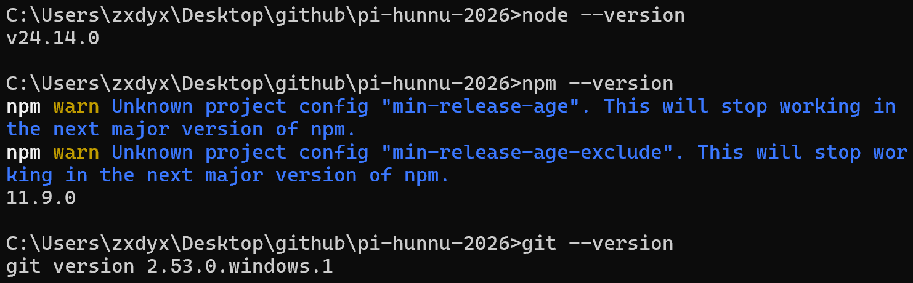
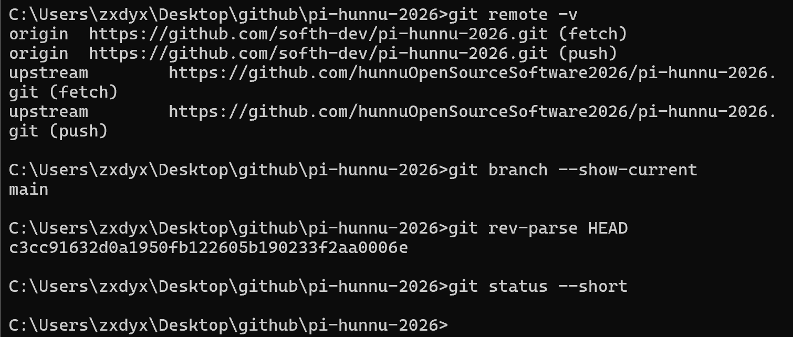
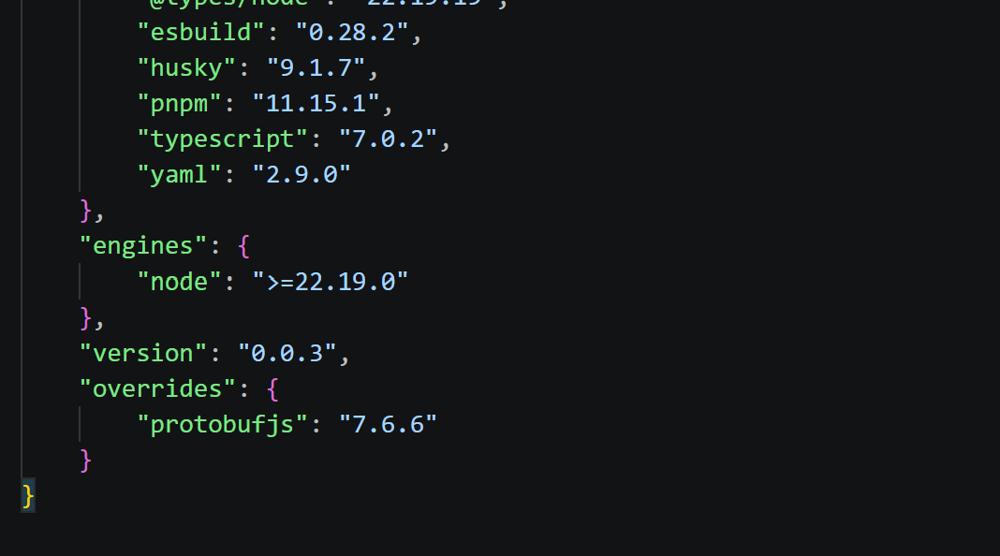
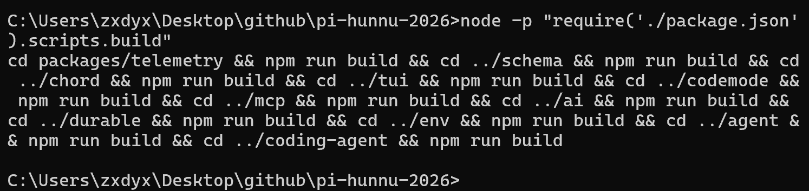
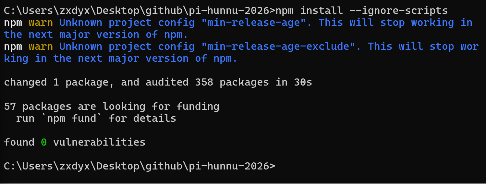
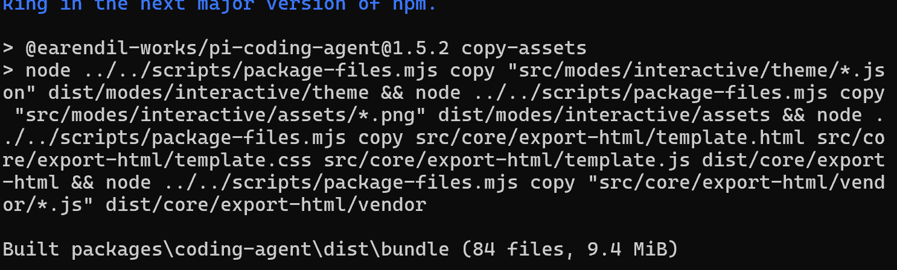
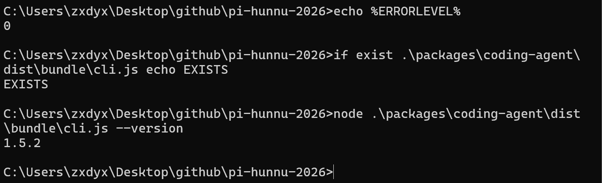
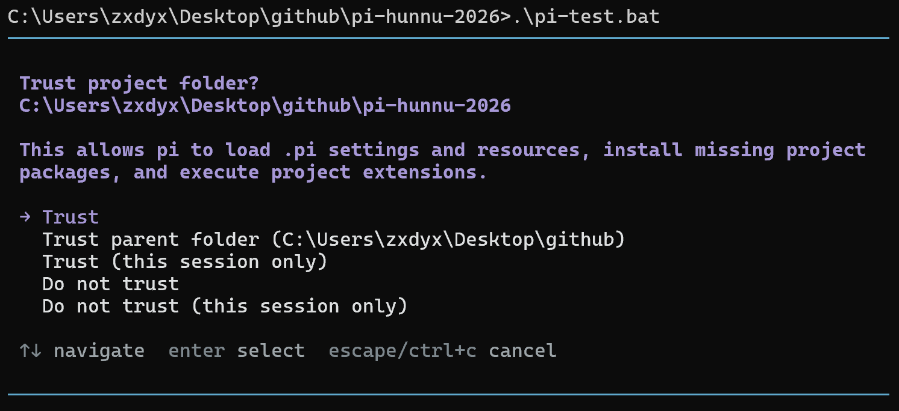
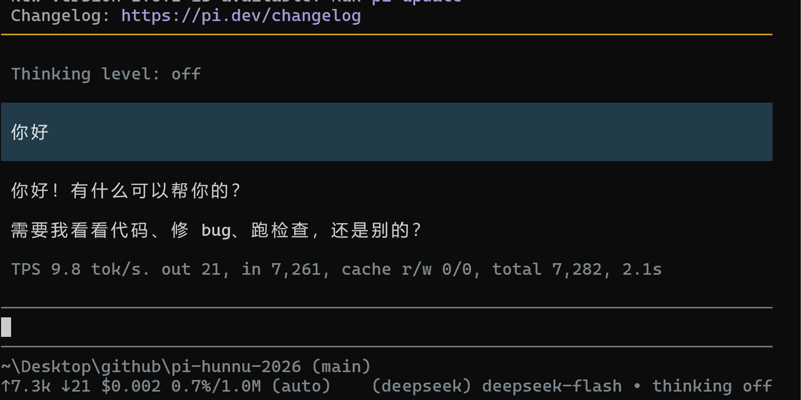

# 实践课3：Pi Agent 源码安装与编译

本报告对应指导书 03-Pi-Agent-source-build.md 的六项任务。全部操作在仓库根目录 `C:\Users\zxdyx\Desktop\github\pi-hunnu-2026` 下完成，截图放在同目录 `截图` 下。

## 一 环境检查（S1）

1. 操作位置：Windows 命令提示符 cmd，工作目录为仓库根目录。
2. 操作命令：

```bat
node --version
npm --version
git --version
```

3. 实际版本：

| 工具 | 版本 |
|---|---|
| Node.js | v24.14.0 |
| npm | 11.9.0 |
| Git | git version 2.53.0.windows.1 |

4. 版本要求说明：根 `package.json` 的 `engines.node` 为 `>=22.19.0`。本次按课程建议使用 Node 24 LTS，实际为 v24.14.0，安装与构建过程中没有出现 EBADENGINE。指导书提到的旧分支 `gondolin@0.12.0` 要求 Node `>=23.6.0` 的情况本次不存在，本仓库实际安装的 `gondolin@0.14.0` 同样声明 `>=22.19.0`。

5. 截图：



## 二 源码位置与版本（S2）

1. 操作位置：仓库根目录。
2. 操作命令：

```bat
git remote -v
git branch --show-current
git rev-parse HEAD
git status --short
```

3. 实际结果：

| 项 | 结果 |
|---|---|
| 本地路径 | C:\Users\zxdyx\Desktop\github\pi-hunnu-2026 |
| origin | https://github.com/softh-dev/pi-hunnu-2026.git |
| upstream | https://github.com/hunnuOpenSourceSoftware2026/pi-hunnu-2026.git |
| 当前分支 | main |
| 提交编号 | c3cc91632d0a1950fb122605b190233f2aa0006e |
| 工作区状态 | 干净，`git status --short` 无输出 |

4. 截图：



## 三 安装与编译的依据（S3）

1. 操作位置：仓库根目录的 `package.json`，用编辑器打开。
2. 观察到的两个配置：
   1. `engines.node` 为 `>=22.19.0`。
   2. `scripts.build` 为一条用 `&&` 串联的命令：依次 `cd` 进入 telemetry 与 schema 与 chord 与 tui 与 codemode 与 mcp 与 ai 与 durable 与 env 与 agent 与 coding-agent，并在每个包里执行该包自己的 `npm run build`。
3. 两个问题的回答：
   1. Node.js 版本要求写在哪里：写在根 `package.json` 的 `engines.node` 字段，值为 `>=22.19.0`；各个依赖包还可以在自己的 `package.json` 里声明更高的下限，安装时的 EBADENGINE 警告就是由这种不一致触发的。
   2. `npm run build` 实际从哪里读取命令：从根 `package.json` 的 `scripts.build` 读取。根脚本只负责按顺序进入各个子包，真正的编译命令来自每个子包 `package.json` 的 `scripts.build`，例如多数包是 `tsc -p tsconfig.build.json`。
4. 关于 workspaces：根 `package.json` 的 `workspaces` 包含 `packages/*` 与 `apps/*` 以及若干示例目录。依赖统一在根目录安装，子包通过工作区链接出现在 `node_modules/@earendil-works` 下，不要给子包单独创建 lock 文件。
5. 截图：





说明：S3b 用 `node -p "require('./package.json').scripts.build"` 打印 `scripts.build` 的完整取值，命令本身也表明了该值来自根 `package.json`。

## 四 安装依赖（S4）

1. 操作位置：仓库根目录，确认存在根 `package.json`。
2. 操作命令：

```bat
npm install --ignore-scripts
```

3. 安装结果：`changed 1 package, and audited 358 packages in 30s`，随后提示 57 个包在寻找资助，最后 `found 0 vulnerabilities`，命令正常返回提示符，输出中没有 error 行。
4. 结果判定：本次是增量安装，依赖此前已经装好，所以只变更 1 个包，不是失败。以 `audited 358 packages` 与 `found 0 vulnerabilities` 和是否出现 error 行判断成功。
5. 命令作用说明：
   1. 按 `package.json` 与 `package-lock.json` 解析并下载依赖，锁文件与声明一致时使用锁定版本。
   2. 在本地建立 `node_modules`，并把工作区内的本地包链接为 `@earendil-works/*` 包。
   3. `--ignore-scripts` 跳过安装阶段自动触发的生命周期脚本，例如 `postinstall` 与 `prepare`。本仓库根的 `prepare` 是 husky，因此提交钩子不会安装，但这不影响后续主动执行 `npm run build`。
6. 警告分类说明：
   1. `Unknown project config "min-release-age"` 与 `min-release-age-exclude`：这两项是 pnpm 的配置，npm 不认识，属于告警，不影响安装。
   2. `EBADENGINE`：Node.js 不满足某个包声明的版本要求。本次没有出现，说明 Node 24.14.0 满足当前依赖树。
   3. `deprecated`：依赖已弃用的提示。本次安装输出中没有出现。
   4. `vulnerabilities`：本次为 `found 0 vulnerabilities`，只表示该次审计没有报告已知漏洞，不能当作构建成功的证明。
7. 截图：



## 五 编译与产物验证（S5）

1. 操作位置：仓库根目录。
2. 操作命令。当前终端是 cmd，所以退出码与文件存在分别用 `echo %ERRORLEVEL%` 与 `if exist`：

```bat
npm run build
echo %ERRORLEVEL%
if exist .\packages\coding-agent\dist\bundle\cli.js echo EXISTS
node .\packages\coding-agent\dist\bundle\cli.js --version
```

3. 实际结果：

| 项 | 结果 |
|---|---|
| 构建退出码 | 0 |
| 入口文件存在 | EXISTS |
| 版本号输出 | 1.5.2 |
| 构建耗时 | 约 1 到 2 分钟，大部分时间用于抓取模型目录 |

4. 首次构建需要联网获取模型目录数据的说明：构建到 ai 包时会执行 `generate-models`，从 models.dev 与 OpenRouter 与 Vercel AI Gateway 与 NVIDIA 与 Radius 等上游抓取模型目录，本次统计到 1687 个可工具调用模型。这是模型目录与能力配置数据，不是下载大模型权重，与模型推理服务是两件事。
5. 产物位置与修改原则：`dist` 是构建产物，需要改程序时应修改 `src` 下的源码再重新构建；直接修改 `dist` 中的文件会在下次构建时被覆盖。
6. 后续重新构建：首次构建成功且模型目录数据仍有效后，可以使用 `npm run build:offline`。它仍会重新编译相关包，但复用已有模型目录数据；不要把它当作首次安装或首次数据初始化的替代命令。
7. 截图。S5a 为构建结尾输出，S5b 为退出码、入口存在与版本号三项验证：





## 六 运行本地源码并完成一次会话（S6）

1. 操作位置：仓库根目录。
2. 操作命令：

```bat
.\pi-test.bat --version
.\pi-test.bat
```

3. 会话内容：
   1. 输入的问题：你好
   2. 模型回复要点：你好！有什么可以帮你的？需要我看看代码、修 bug、跑检查，还是别的？
   3. 状态栏显示模型为 deepseek-flash，思考级别为 off，工作目录为仓库根目录。
4. 启动过程：首次运行时出现 Trust project folder 对话框，选择 Trust 后进入交互界面。
5. 如何确认运行的是本地源码：`pi-test.bat` 调用 `pi-test.ps1`，由 Node.js 加载源码解析器并运行 `packages/coding-agent/src/cli.ts`，而不是已安装的全局版本；界面状态栏的工作目录也是仓库根目录。直接输入 `pi` 可能启动第一次实践课安装的全局版本，无法单独证明运行的是刚下载的源码。
6. 两个入口的适用场景：源码入口适合开发调试，改动 `src` 后直接生效，不需要先构建；`dist/bundle/cli.js` 是构建产物入口，适合验证构建结果，形态更接近发布版本。
7. 截图：





## 七 困难与解决（重点）

| 序号 | 困难现象 | 原因 | 解决办法 |
|---|---|---|---|
| 1 | 在 cmd 中执行 `$LASTEXITCODE` 与 `Test-Path` 报“不是内部或外部命令” | 这两条是 PowerShell 语法，cmd 不识别 | 改用 cmd 语法 `echo %ERRORLEVEL%` 与 `if exist`，或切到 PowerShell 并使用 `npm.cmd` |
| 2 | 每条 npm 命令都输出 `Unknown project config "min-release-age"` 告警 | 仓库 `.npmrc` 里是 pnpm 的配置项，npm 11 不认识 | 确认为告警，不影响安装与构建，按噪声处理 |
| 3 | 安装输出只有 `changed 1 package`，不像全新安装 | 依赖此前已经装好，本次是增量安装 | 结合 `audited 358 packages` 与 `found 0 vulnerabilities` 判断安装成功 |
| 4 | 首次构建在 ai 包处长时间停在 `Fetching models.dev catalog...` | 生成模型目录需要联网抓取六个上游，过程没有进度提示 | 等待完成；数据就绪后改用 `npm run build:offline` |

## 八 附 文件清单

1. 报告：本文件 `报告.md`。
2. 截图：同目录 `截图` 下，共 9 张。
3. 仓库地址：https://github.com/zx-123470/---/tree/main/pi作业3
