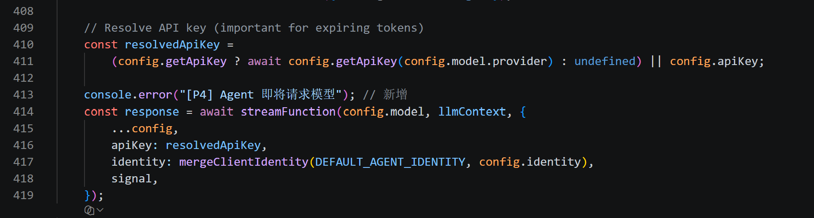
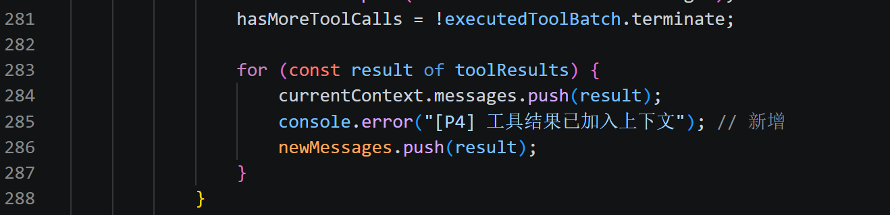
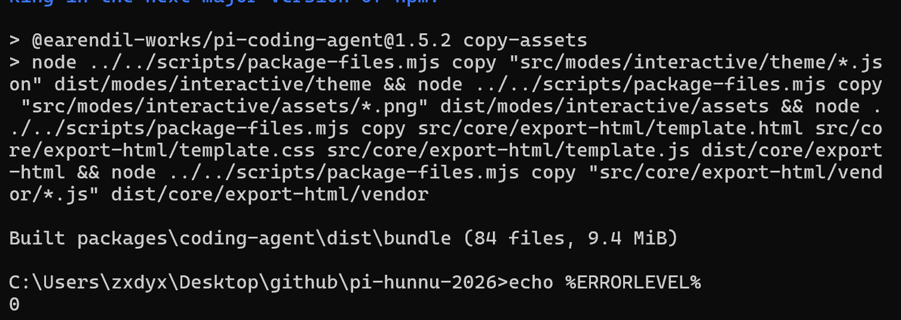
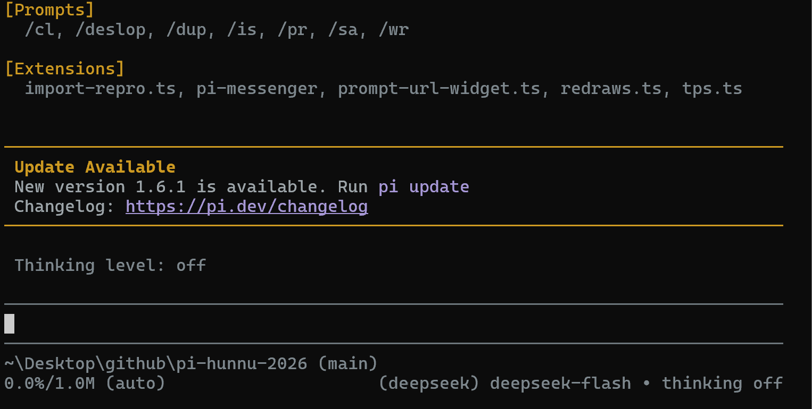
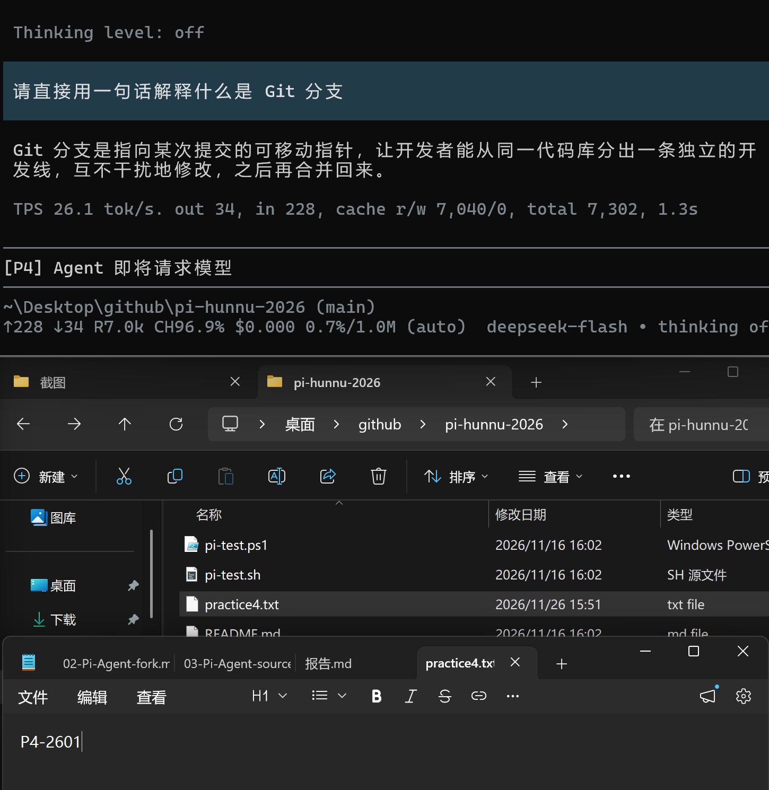
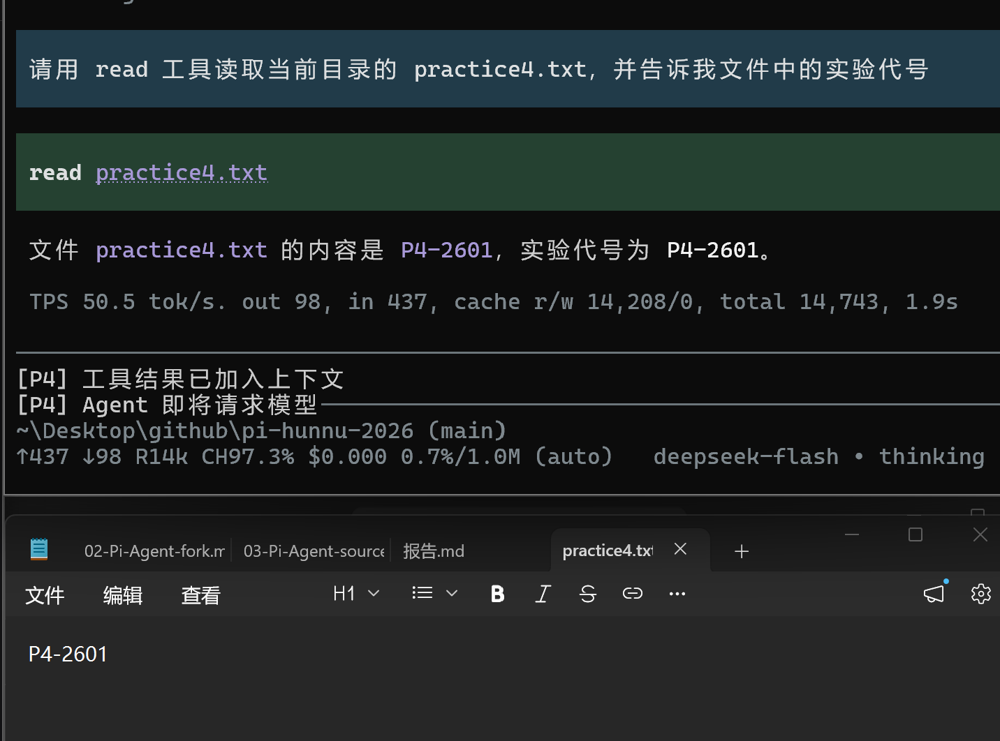
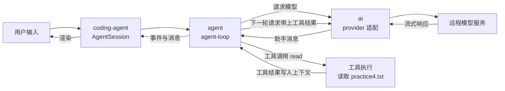

# 实践课4：Pi Agent 的模型调用与运行流程

本报告对应指导书 04-Pi-Agent-run.md。全部操作在仓库根目录 `C:\Users\zxdyx\Desktop\github\pi-hunnu-2026` 下完成，截图放在同目录 `截图` 下。

## 一 源码修改（S1、S2）

修改文件：`packages/agent/src/agent-loop.ts`。两处都只是 `console.error`，不改变循环逻辑，日志写到 stderr。

1. 第一处，在模型调用前打印。插入位置在原第 412 行 `const response = await streamFunction(...)` 上方：

```ts
	console.error("[P4] Agent 即将请求模型"); // 新增
	const response = await streamFunction(config.model, llmContext, {
		...config,
		apiKey: resolvedApiKey,
		identity: mergeClientIdentity(DEFAULT_AGENT_IDENTITY, config.identity),
		signal,
	});
```

2. 第二处，在工具结果写入上下文后打印。插入位置在原第 284 行 `currentContext.messages.push(result);` 下方，位于 for 循环内：

```ts
			for (const result of toolResults) {
				currentContext.messages.push(result);
				console.error("[P4] 工具结果已加入上下文"); // 新增
				newMessages.push(result);
			}
```

3. 插入后的实际行号：第二处在 283 到 286 行，第一处在 412 到 413 行。

4. 截图。S1 为第一处，S2 为第二处：





## 二 重新编译与启动（S3、S4）

1. 操作位置：仓库根目录 cmd。
2. 编译命令：

```bat
npm run build
echo %ERRORLEVEL%
```

3. 编译结果：退出码 0，构建结尾输出为 `Built packages\coding-agent\dist\bundle (84 files, 9.4 MiB)`。
4. 启动编译产物：

```bat
node .\packages\coding-agent\dist\cli.js
```

5. 启动结果：正常打开 Pi 交互界面，界面显示已加载的扩展列表、`Thinking level: off`，状态栏工作目录为仓库根目录，模型为 deepseek-flash。
6. 截图：





## 三 两次会话对比（S5、S6）

实验文件：仓库根目录 `practice4.txt`，内容为一行的自定实验代号 `P4-2601`。两次会话使用同一模型，且都在新会话中进行。

### 会话 A 直接问答

1. 输入指令：请直接用一句话解释什么是 Git 分支。
2. 是否调用工具：否。
3. 实际 [P4] 日志，按出现顺序抄录：

```text
[P4] Agent 即将请求模型
```

4. 进入的模型调用轮数：1 轮。
5. 最终回复：Git 分支是指向某次提交的可移动指针，让开发者能从同一代码库分出一条独立的开发线，互不干扰地修改，之后再合并回来。
6. 截图：



### 会话 B 读取文件

1. 输入指令：请用 read 工具读取当前目录的 practice4.txt，并告诉我文件中的实验代号。
2. read 工具的读取记录：`read practice4.txt`。
3. 回复中的实验代号：`P4-2601`。
4. 实际 [P4] 日志，按出现顺序抄录。本次截图窗口起于 read 之后，B 的首轮“即将请求模型”在滚动区外，图中可见的两条为：

```text
[P4] 工具结果已加入上下文
[P4] Agent 即将请求模型
```

5. 进入的模型调用轮数：2 轮。第一轮请求模型并得到 read 工具调用，工具执行后第二轮请求模型并得到最终回复。
6. 最终回复：文件 practice4.txt 的内容是 P4-2601，实验代号为 P4-2601。
7. 截图：



## 四 运行流程说明

1. 谁实际读了文件：是 agent 这一层执行了 read 工具，工具在本地读取磁盘；ai 层只负责把请求发给模型并处理流式响应；远程模型服务本身不接触本地文件。
2. 下一轮模型请求多带了什么：多带了工具结果消息。`currentContext.messages.push(result)` 把 read 的返回值写进上下文，下一轮请求把这些消息一起发给模型，所以模型才能复述文件里的代号。
3. 两次会话的差别：会话 A 没有任何工具调用，只出现一次“即将请求模型”；会话 B 先请求模型并拿到工具调用，执行 read 后再请求一次模型，日志顺序为请求、工具结果、请求，共两轮模型调用。
4. 简图：



## 五 文件清单

1. 报告：本文件 `practice-04.md`。
2. 截图：同目录 `截图` 下，共 6 张。
3. 仓库地址：https://github.com/zx-123470/---/tree/main/pi作业4
