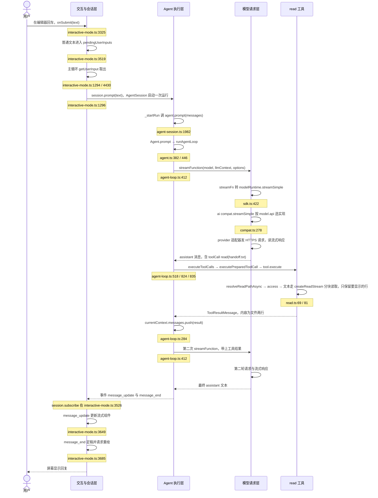
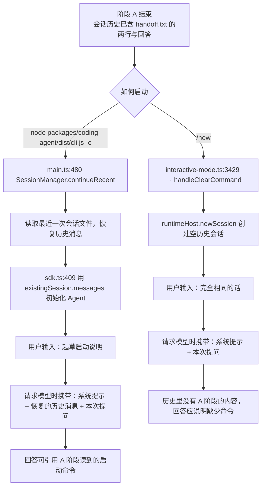

# 实践课5：Pi Agent 工具调用与会话恢复

本报告对应指导书 05-Pi-Agent-source-reading.md。实验在仓库根目录 `C:\Users\zxdyx\Desktop\github\pi-hunnu-2026` 下完成，使用本地构建的 `node .\packages\coding-agent\dist\cli.js` 启动。

## 一 实验准备

1. 在仓库根目录新建 `handoff.txt`，内容为两行：

```text
待办：补充 README 的启动说明
启动命令：npm run demo -- --profile p5-2601
```

2. 阶段 A 的提问：

```text
请用 read 工具读取当前目录的 handoff.txt，原样告诉我待办和启动命令。
```

3. 阶段 B 的提问，恢复会话与新建会话使用完全相同的内容：

```text
接着上次的待办，给 README 起草一条启动说明，写出交接单里的完整启动命令。只用这次会话已有的信息。不要调用工具。如果缺少命令，请直接说明。
```

## 二 单轮工具调用（图 1）

1. 阶段 A 的观察记录：
   1. 工具实际执行次数：1 次，界面出现一行 `read ~\Desktop\github\pi-hunnu-2026\handoff.txt`。
   2. 界面上 read 的显示：`read ~\Desktop\github\pi-hunnu-2026\handoff.txt`。
   3. 最终回复：原样给出交接单两行。

```text
handoff.txt 内容（原样）：

   待办：补充 README 的启动说明
   启动命令：npm run demo -- --profile p5-2601
```

2. 图 1 为这一轮的代码级时序图。五条生命线分别对应用户、交互与会话层、Agent 执行层、模型请求层与 read 工具，箭头上标的是源码里真实的函数或语句。



3. 图 1 中几处需要说明的边界：
   1. 输入入口是交互层编辑器的 `onSubmit`，它先处理斜杠命令，普通文本进入待处理队列，由主循环取出后交给 `session.prompt`。
   2. 循环不在交互层，而在 agent 层：`Agent.prompt` 调 `runAgentLoop`，再进入 `streamAssistantResponse`。
   3. 模型请求层与远端模型之间是 HTTPS 请求加流式响应，适配器由 `model.api` 决定。
   4. 文件读取发生在 read 工具内部，不走模型请求层。文本文件通过 `createReadStream` 分块读取，只保留最终要显示的行；没有流式能力时退回 `readFile` 整体读入。
   5. 工具结果由 `currentContext.messages.push(result)` 写回上下文，第二轮请求才带得上。

## 三 会话恢复对比（图 2）

1. 两次观察记录：

| 项 | 恢复旧会话，加 -c | 新建会话，/new |
|---|---|---|
| 是否调用工具 | 否 | 否 |
| 是否答出完整启动命令 | 是 | 否 |
| 回答摘要 | 起草了 README 启动说明，给出 `npm run demo -- --profile p5-2601`，并说明只用了会话已有内容 | 说明本次会话没有之前的对话上下文，也没有交接单内容，无法起草，要求直接贴出命令全文 |

2. 过程记录：
   1. 加 `-c` 启动后，终端直接回显了阶段 A 的提问与 `read handoff.txt` 的结果，说明历史消息已恢复。
   2. 恢复会话的回答里直接出现了交接单中的完整命令，过程中没有再读取文件。
   3. `/new` 之后界面显示 `New session started`，同样的提问得到的是“没有上下文”的回答。

3. 图 2 为两条分支的对照图，说明两种情况下会把哪些消息发给模型。



4. 结论：恢复旧会话时，模型请求带的是恢复出的历史消息加本次提问，所以不重新读文件也能答出命令；新建会话时历史为空，同样的提问拿不到 A 阶段的信息。两者差别不在提问，而在请求里带的历史消息。

## 四 源码定位

| 环节 | 位置 |
|---|---|
| 输入入口 onSubmit | packages/coding-agent/src/modes/interactive/interactive-mode.ts:3325 |
| 输入入队 | 同文件:3519 pendingUserInputs.push(text) |
| 提交给会话 | 同文件:1296 session.prompt(text) |
| 会话启动循环 | packages/coding-agent/src/core/agent-session.ts:1982 agent.prompt(messages) |
| Agent 入口 | packages/agent/src/agent.ts:382 prompt，446 runAgentLoop |
| 模型请求 | packages/agent/src/agent-loop.ts:412 streamFunction |
| 流式实现 | packages/coding-agent/src/core/sdk.ts:422，packages/ai/src/compat.ts:278 |
| 工具执行 | packages/agent/src/agent-loop.ts:518 / 824 / 835 |
| read 实现 | packages/coding-agent/src/core/tools/read.ts:69 / 81 |
| 工具结果写回 | packages/agent/src/agent-loop.ts:284 |
| 回复显示 | interactive-mode.ts:3526 订阅，3649 message_update，3685 message_end |
| 恢复会话 | packages/coding-agent/src/main.ts:480 SessionManager.continueRecent |
| 新建会话 | interactive-mode.ts:3429 / 7120 runtimeHost.newSession |
| 恢复消息注入 | packages/coding-agent/src/core/sdk.ts:409 messages: existingSession.messages |

## 五 文件清单

1. 报告：本文件 `practive-05.md`。
2. 仓库地址：https://github.com/zx-123470/---/tree/main/pi作业5
